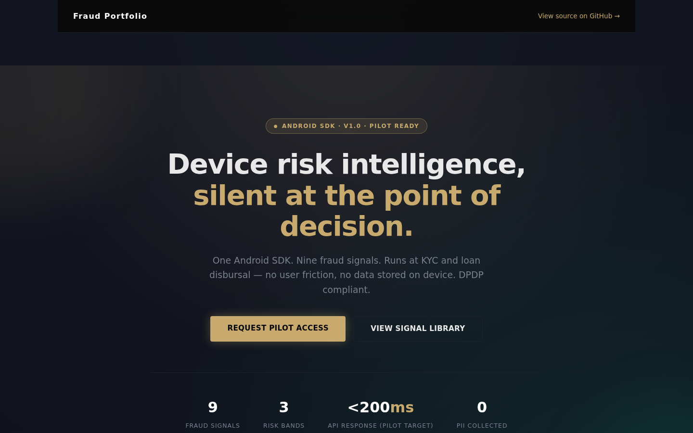

# Android Device Risk SDK

**Status:** v1.0 · Full Kotlin source included · Independent open-source project

**Documentation:** [HOW_TO_BUILD.md](./HOW_TO_BUILD.md) · [LICENSE](./LICENSE)

Maintained by **Gururaj G J** — Senior Fraud Risk | Merchant Risk | Financial Crime Professional
[LinkedIn](https://www.linkedin.com/in/gururaj-gj-52a062b4/) · [GitHub](https://github.com/Gururaj-GJ-G)

---

## What it is

An Android SDK that performs silent device-risk checks at key moments such as KYC onboarding
and loan disbursal — 9 device-level fraud signals, built with a privacy-conscious (DPDP-aligned)
posture, targeted at NBFCs, digital lenders, and BNPL platforms.

## Screenshot



## Why this exists

Loan and onboarding fraud increasingly originates from compromised or manipulated devices
(emulators, rooted devices, hooking frameworks, remote-control apps) rather than stolen
credentials alone. This SDK gives lenders a device-risk signal at the exact moment it matters —
before disbursal — without adding friction for legitimate customers.

## What's in this repo

- **`sdk/`** — the full Kotlin SDK source (`com.gururajgj.devicerisk`), including:
  - `DeviceRiskSdk` — main entry point (`init()`, `assess()`, `assessAsync()`)
  - `detectors/` — root, emulator, hooking-framework, app-risk, and environment detectors
  - `scoring/RiskScorer` — local, on-device scoring
  - `api/DeviceRiskApiClient` — optional backend call for hybrid scoring
  - `exceptions/` — typed SDK exceptions
- **`HOW_TO_BUILD.md`** — step-by-step guide to building the `.aar` in Android Studio
- **`product-page-demo.html`** — a self-contained product overview / interactive walkthrough

## Architecture

Three scoring modes, controlled via `DeviceRiskConfig.mode`:

- **`LOCAL_ONLY`** — all 9 signals scored entirely on-device, no network call
- **`HYBRID`** (default) — local detection is sent to a configurable backend for scoring; falls
  back to the local score if the backend is unreachable
- **`API_ONLY`** — scoring always deferred to the backend

A `shadowMode` flag (default `true`) lets you pilot the SDK safely: risk is computed and logged,
but the SDK always reports `LOW` to your app until you're ready to act on real scores.

The API client (`DeviceRiskApiClient`) is a thin wrapper over `HttpURLConnection` — no OkHttp
dependency, to keep the SDK's footprint minimal. `DeviceRiskApiClient.DEFAULT_BASE_URL` is a
placeholder; point `DeviceRiskConfig.apiBaseUrl` at your own backend to use hybrid/API-only mode.

## Integration

```kotlin
// In Application.onCreate():
DeviceRiskSdk.init(this, "your_api_key", DeviceRiskConfig(shadowMode = true))

// At KYC start or before disbursal confirmation:
val result = DeviceRiskSdk.assess(context, sessionId)
when (result.riskBand) {
    RiskBand.LOW    -> proceedNormally()
    RiskBand.MEDIUM -> stepUpVerification()
    RiskBand.HIGH   -> holdForReview()
}
```

See [HOW_TO_BUILD.md](./HOW_TO_BUILD.md) for building the `.aar` from source in Android Studio.

## Use cases

NBFCs, digital lenders, and BNPL platforms that need a device-risk signal at onboarding or
disbursal, without building device-fingerprinting infrastructure from scratch.

## License

MIT — see [LICENSE](./LICENSE).
